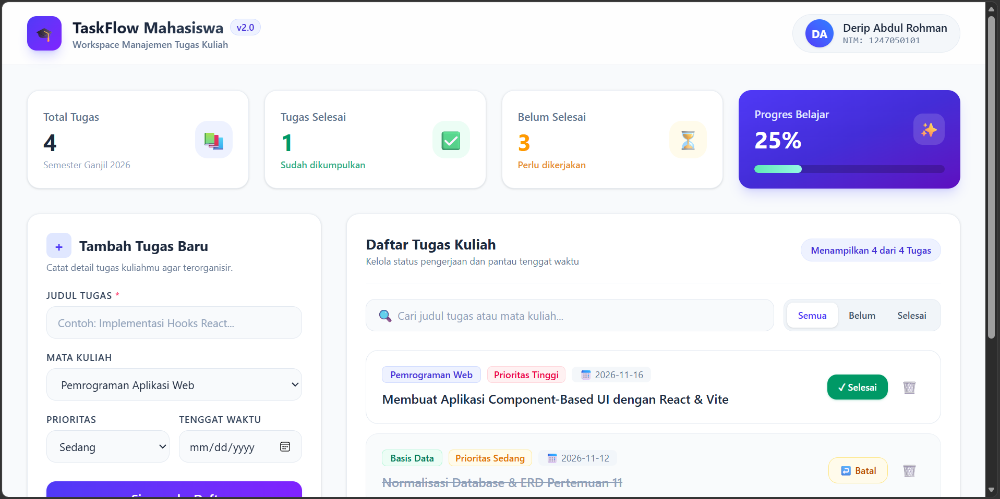

# 🎓 TaskFlow Mahasiswa - Dashboard Tugas Kuliah

Aplikasi web manajemen tugas kuliah modern berbasis **Component-Based UI Development** menggunakan **React**, **Vite**, dan **Tailwind CSS**. Proyek ini dibuat untuk memenuhi **Tugas Pertemuan 7 - Pengembangan Aplikasi Web**.

## 👤 Identitas Mahasiswa
* **Nama:** Derip Abdul Rohman
* **NIM:** 1247050101
* **Repository GitHub:** [derip14/dashboard-tugas-react](https://github.com/derip14/dashboard-tugas-react)

---
## 📸 Pratinjau Aplikasi


## ✨ Fitur Utama
1. **Ringkasan Statistik & Progres Real-Time:** Menampilkan jumlah total tugas, tugas selesai, tugas belum selesai, serta *progress bar* persentase penyelesaian secara otomatis.
2. **Tambah Tugas Baru:** Formulir interaktif untuk mencatat judul tugas, memilih kategori mata kuliah, menentukan tingkat prioritas, dan menetapkan tenggat waktu.
3. **Pencarian & Filter Status:** Memudahkan pencarian tugas berdasarkan judul atau mata kuliah, serta penyaringan status (*Semua*, *Belum*, *Selesai*).
4. **Ubah Status & Hapus Tugas:** Mendukung pembaruan status pengerjaan (Selesai/Batal) dengan indikator visual coretan (*strikethrough*) serta penghapusan item tugas.
5. **Desain Modern & Responsif:** Tampilan antarmuka bersih (*clean light mode*) yang menyesuaikan ukuran layar desktop maupun perangkat mobile.

---

## 🧩 Arsitektur Komponen React (`src/components/`)
Aplikasi ini dipecah menjadi 6 komponen terpisah yang dapat digunakan kembali (*reusable components*):
* **`Header.jsx`**: Menampilkan navigasi utama, identitas aplikasi, serta profil nama dan NIM mahasiswa.
* **`StatsCard.jsx`**: Menghitung dan menampilkan statistik pengerjaan tugas serta *progress bar* dinamis.
* **`TaskForm.jsx`**: Mengelola input formulir tugas baru menggunakan *local state* (`useState`) dan mengirim data ke komponen induk melalui *props*.
* **`FilterBar.jsx`**: Komponen kontrol untuk menangani input pencarian (*search query*) dan tombol tab filter status.
* **`TaskList.jsx`**: Merender daftar tugas menggunakan metode `.map()` (*List Rendering*) serta menerapkan *Conditional Rendering* saat daftar tugas kosong.
* **`TaskItem.jsx`**: Komponen kartu satuan untuk setiap item tugas beserta penanganan aksi tombol (*Event Handling*).

---

## 🛠️ Teknologi yang Digunakan
* [React](https://react.dev/) (UI Library)
* [Vite](https://vitejs.dev/) (Build Tool & Dev Server)
* [Tailwind CSS](https://tailwindcss.com/) (Utility-First CSS Framework)

---

## 🚀 Cara Menjalankan Proyek di Lokal

1. **Clone repository ini:**
   ```bash
   git clone [https://github.com/derip14/dashboard-tugas-react.git](https://github.com/derip14/dashboard-tugas-react.git)